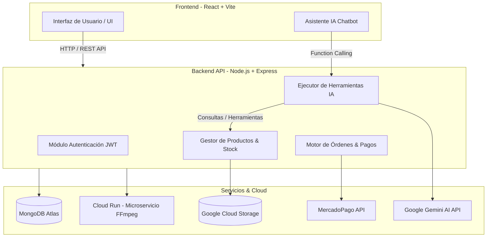

# 🎮 Buff Store - Aplicación Web para la Comercialización de Productos Digitales

<div align="center">

  

  **Una plataforma de comercio electrónico moderna, segura y escalable para la distribución instantánea de videojuegos, claves digitales y microtransacciones.**

  [](https://react.dev/)
  [](https://nodejs.org/)
  [](https://expressjs.com/)
  [](https://www.mongodb.com/)
  [](https://tailwindcss.com/)
  [](https://cloud.google.com/)

</div>

---

## 📌 Visión General del Proyecto

**Buff Store** es una solución Full-Stack diseñada para resolver los desafíos clave en la venta de licencias digitales de software y videojuegos: **velocidad de entrega, alta disponibilidad y una experiencia de usuario fluida e interactiva**.

La arquitectura está construida bajo una visión desacoplada y orientada a servicios, ofreciendo un panel de administración completo, un checkout rápido integrado con pasarelas de pago líderes y asistencia impulsada por Inteligencia Artificial generativa para enriquecer la navegación del usuario.

---

## 🌟 Características Principales

### 🛒 Tienda & Experiencia de Usuario
- **Catálogo Dinámico & Búsqueda Avanzada:** Filtros en tiempo real, categorización por plataformas (PC, PlayStation, Xbox) y búsqueda optimizada por palabras clave.
- **Asistente Virtual con IA (Gemini Integration):** Chatbot inteligente capaz de responder inquietudes del catálogo, recomendar títulos según preferencias y procesar imágenes de carátulas para identificar videojuegos mediante visión artificial.
- **Favoritos & Sincronización:** Persistencia local y fusión automática (`merge`) al iniciar sesión.
- **Sistema de Reseñas y Valoraciones:** Opiniones verificadas por producto con cálculo automático de estadísticas y promedio de puntuación.

### 💳 Checkout & Procesamiento de Órdenes
- **Integración con MercadoPago SDK:** Checkout transparente para procesamiento seguro de pagos con tarjeta de crédito, débito y métodos locales.
- **Entrega Autómata de Códigos Digitales:** Sistema de asignación atómica de llaves de activación de videojuegos (`GameCodes`) asociadas al pago aprobado.
- **Notificaciones por Email:** Envío automático de confirmación de compra y llaves digitales en formato estructurado mediante **Resend**.

### ⚙️ Microservicios & Multimedia Avanzada
- **Procesador de Video Asíncrono (Cloud Run + Docker):** Microservicio dedicado para la transcodificación, optimización de video (`FFmpeg`) y generación automática de miniaturas sin bloquear el hilo principal del servidor.
- **Almacenamiento Cloud:** Gestión eficiente de medios estáticos (imágenes y trailers de videojuegos) con **Google Cloud Storage**.
- **Metadatos Automatizados (RAWG API):** Sincronización automática de detalles técnicos, fechas de lanzamiento y métricas de Metacritic.

### 🔐 Seguridad & Administración
- **Panel Administrativo Completo:** Gestión de inventarios, stock, banners de destacados, monitoreo de ventas y reportes de usuarios.
- **Control de Acceso basado en Roles (RBAC):** Autenticación mediante **JWT** y control de permisos granular en middleware de servidor.

---

## 📐 Arquitectura del Sistema



---

## 🛠️ Stack Tecnológico

### **Frontend**
- **Core:** React 19, Vite
- **Estilos & UI:** Tailwind CSS, Lucide Icons
- **Enrutamiento & HTTP:** React Router DOM, Axios

### **Backend**
- **Runtime & Framework:** Node.js 22, Express 5
- **ORM / Base de Datos:** Mongoose 8, MongoDB Atlas
- **Seguridad & Sesión:** JWT (JSON Web Tokens), Bcryptjs

### **Cloud & Microservicios**
- **IA & Multimodal:** `@google/genai` (Gemini Flash & Vision)
- **Almacenamiento:** `@google-cloud/storage`
- **Procesamiento de Video:** Docker, Node.js, FFmpeg (`fluent-ffmpeg`)
- **Emailing:** Resend API, React Email

---

## 💡 Enfoque de Ingeniería y Buenas Prácticas

El desarrollo de **Buff Store** demuestra un sólido dominio de principios de ingeniería de software moderna:

- **Diseño de APIs RESTful:** Rutas estructuradas, manejo consistente de códigos de estado HTTP y middlewares modularizados.
- **Asincronía & Procesamiento Pesado:** Delegación del cómputo exigente (compresión de video) a un microservicio aislado para evitar bloqueos del Event Loop.
- **Integración de IA Práctica:** Implementación de *Function Calling* en modelos de lenguaje para permitir que el chatbot consulte y opere sobre la base de datos de manera segura según el rol del usuario.
- **Resiliencia & Fallbacks:** Mecanismos de reintento (`exponential backoff`) en integraciones con APIs externas y modelos de IA.
- **Gestión de Datos Atómica:** Manejo riguroso de concurrencia al reclamar llaves digitales de productos para evitar choques o entregas duplicadas.

---

## 🚀 Instalación y Configuración Local

### **Requisitos Previos**
- Node.js (v18+)
- MongoDB (Instancia local o cluster en Atlas)
- Cuenta de Google Cloud (Bucket de Storage)
- Credenciales API (MercadoPago, Gemini, RAWG, Resend)

### **Pasos para Ejecución**

1. **Clonar el repositorio:**
   ```bash
   git clone https://github.com/tu-usuario/buff-store.git
   cd buff-store
   ```

2. **Configurar el Backend (`/server`):**
   ```bash
   cd server
   npm install
   # Crear archivo .env basado en la configuración requerida
   npm run dev
   ```

3. **Configurar el Frontend (`/frontend`):**
   ```bash
   cd ../frontend
   npm install
   npm run dev
   ```

4. **Microservicio de Video (`/video-processor` - Opcional Local / Docker):**
   ```bash
   cd ../video-processor
   docker build -t video-processor .
   docker run -p 8080:8080 video-processor
   ```

---


<div align="center">
  <sub>Desarrollado con pasión para la comunidad Gamer 🎮</sub>
</div>
